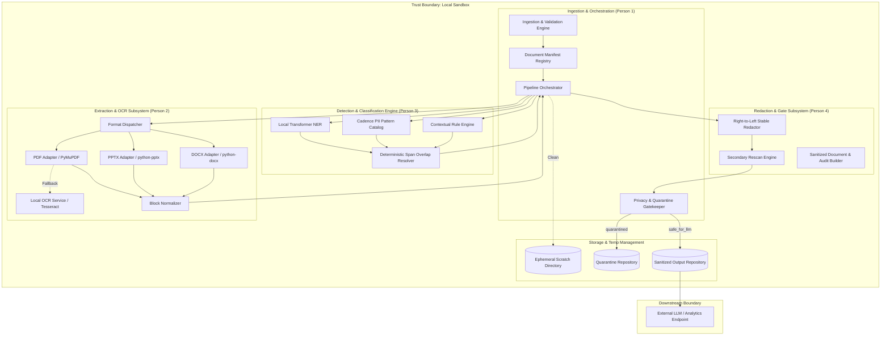

# Cadence Detection Pipeline - Technical Architecture

**Version:** 1.0.0-final
**Lead Owner:** Person 1 (Architecture, Ingestion, and Integration Lead)
**Security Classification:** Highly Confidential / Local Processing Only

---

## 1. System Overview and Goals

The Cadence Detection System is a modular, high-assurance document sanitization pipeline engineered to process complex institutional documents across PDF, PowerPoint (PPTX), and Word (DOCX) formats. It detects, classifies, and redacts Personally Identifiable Information (PII) before any transmission to external Large Language Models (LLMs).

### Key Architectural Tenets
1. **Local-Only Processing Boundary:** No raw text, raster image, or metadata leaves the trusted perimeter.
2. **Deterministic & Idempotent:** Document IDs derive cryptographically from content byte SHA-256.
3. **Fail-Closed Privacy Gate:** Any incomplete extraction, OCR degradation, or residual PII candidate immediately triggers **Quarantine**, never a silent safe release.
4. **Zero-PII Auditability:** Audit reports, logs, and telemetry track counts, types, offsets, and checksums—never raw PII values.

---

## 2. Component Architecture & Responsibilities



---

## 3. Format-Specific Extraction and Media Handling

### 3.1 PDF: Native Extraction vs. OCR Fallback
- **Dual-Path Strategy:**
  1. *Native PDF Parsing:* Used when high-density selectable digital text streams exist.
  2. *OCR Fallback:* Activated automatically when pages have no extractable native text, or when text density falls below `min_text_density_threshold` (e.g., scanned contracts, screenshot attachments).
- **Risk Policy v6.0 Handling:** 35 scanned pages consisting of full-page raster scans and embedded screen captures (e.g., page 9 identity cards, page 18 signed attestation, page 20 audit log). The PDF adapter automatically routes each raster page through the local OCR engine, calculating per-block spatial bounding boxes and confidence scores.
- **Low-Confidence OCR Thresholding:**
  - Blocks with OCR confidence $< 0.75$ trigger a warning.
  - Documents with mean OCR confidence $< 0.70$ or containing illegible critical blocks are quarantined (`LOW_OCR_CONFIDENCE`).

### 3.2 PPTX & DOCX: Office Open XML & Embedded Media
- **PPTX Traversal:** Traverses slide shapes, group shapes, structured tables, and speaker notes. Handles the 9-slide Organizational Pack with divisional hierarchies and RACI matrices.
- **DOCX Traversal:** Iterates through body paragraphs, 16 structured tables, and headers/footers in the TPRM Training document.
- **Embedded Media & Unsupported Vector Formats:**
  - Raster media (PNG, JPEG) embedded in DOCX/PPTX are passed to the OCR subsystem if configured.
  - Vector/Metafile media (SVG, EMF, WMF): The TPRM Training contains 41 media entries including EMF and SVG files. If an embedded format cannot be reliably converted or parsed for text/PII, the pipeline flags `UNSUPPORTED_EMBEDDED_MEDIA` and quarantines the document for human review.

---

## 4. Security, Validation, and Failure Paths

### 4.1 Input Validation Matrix

| Threat / Anomaly | Detection Mechanism | Action / Quarantine Reason |
|---|---|---|
| **Oversized File** | Byte length check against `max_file_size_bytes` | Reject at ingestion: `FILE_OVERSIZED` |
| **MIME / Extension Mismatch** | Magic bytes verification (`%PDF-`, `PK\x03\x04`) vs extension | Reject at ingestion: `MIME_EXTENSION_MISMATCH` |
| **Unsupported Format** | Extension and MIME check | Reject at ingestion: `UNSUPPORTED_FORMAT` |
| **Corrupt File** | Zip integrity check (`bad_zip_file`) or malformed PDF trailer | Quarantine: `CORRUPT_FILE` |
| **Password Protected / Encrypted** | PDF encryption flag / Zip encrypted flag inspection | Quarantine: `PASSWORD_PROTECTED` |
| **Extraction Failure** | Adapter exception or zero blocks extracted | Quarantine: `EXTRACTION_FAILED` |
| **Incomplete Structure** | Missing expected sections / structure score failure | Quarantine: `EXTRACTION_INCOMPLETE` |
| **Low OCR Confidence** | Mean OCR score below threshold | Quarantine: `LOW_OCR_CONFIDENCE` |
| **Residual PII on Rescan** | Secondary detection identifies candidate entities | Quarantine: `RESCAN_FAILED` |

### 4.2 Deterministic Document Identifiers
To prevent duplicate processing and provide tamper-evident tracing:
$$\text{document\_id} = \text{SHA-256}(\text{raw\_document\_bytes})$$
The document ID remains stable across renames, uploads, and retries.

### 4.3 Temporary Files and Ephemeral Storage Policy
- Processing scratch spaces are created under secure temporary paths with restricted permissions (`0700`).
- Context managers guarantee that temporary images and page rasters are deleted upon completion or error.
- Raw source documents are explicitly ignored in `.gitignore` and excluded from git commits.

### 4.4 Logging and Observability Without PII Leakage
- **Log Sanitation Rule:** Log messages may contain `document_id`, `block_id`, `entity_type`, `character_span_length`, `confidence`, and `quarantine_reason`.
- **Strictly Prohibited:** Raw entity text values, names, emails, phone numbers, or unredacted block text are strictly forbidden in standard log streams.

---

## 5. Privacy Gate & Safe-Release Criteria

The orchestrator enforces a zero-bypass Privacy Gate. A document receives `ReleaseDecision.safe_for_llm` if and only if **all** of the following conditions are met:

```
[VALIDATION SUCCESS]
         AND
[EXTRACTION COMPLETE == TRUE]
         AND
[MEAN OCR CONFIDENCE >= THRESHOLD]
         AND
[UNSUPPORTED MEDIA COUNT == 0]
         AND
[DETECTION STATUS == COMPLETED]
         AND
[REDACTION STATUS == COMPLETED]
         AND
[RESCAN RESIDUAL CANDIDATES == 0]
         AND
[QUARANTINE REASONS IS EMPTY]
```

If any single clause evaluates to false:
- `status = ProcessingStatus.quarantined`
- `release_decision = ReleaseDecision.not_safe_for_llm`

---

## 6. Batch & Concurrency Scaling Model

For enterprise-scale batch operations across large document repositories:
1. **Stateless Orchestration:** The `PipelineOrchestrator` is purely stateless and re-entrant. Multiple document manifests can be processed in parallel across worker processes.
2. **Worker Pool Isolation:** OCR and heavy parsing tasks run in dedicated worker pools, bounded by CPU cores to prevent memory saturation.
3. **Quarantine Isolation:** Quarantined items are segregated into a dedicated quarantine store with structured metadata explaining the exact trigger, allowing compliance officers to triage and review.
